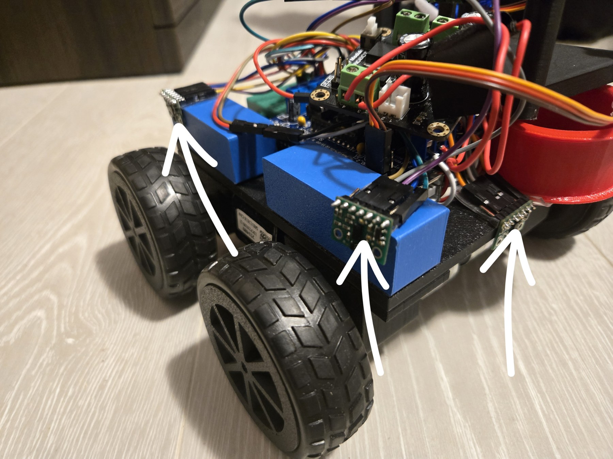
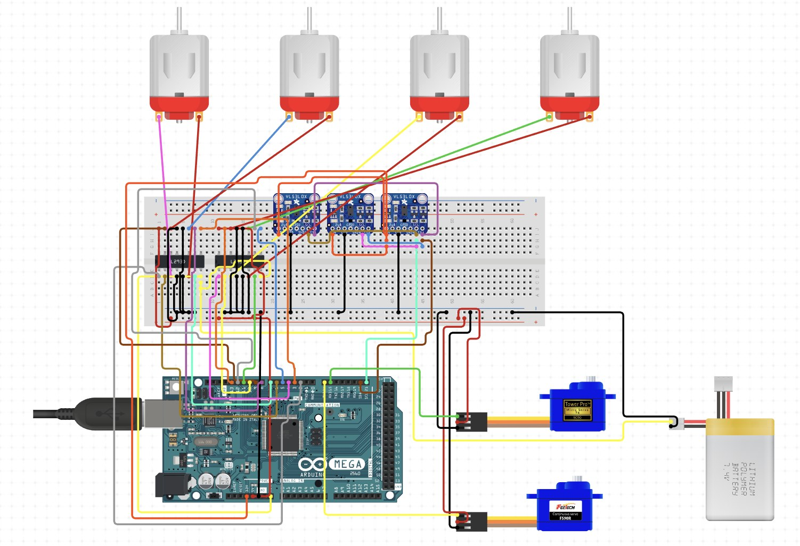
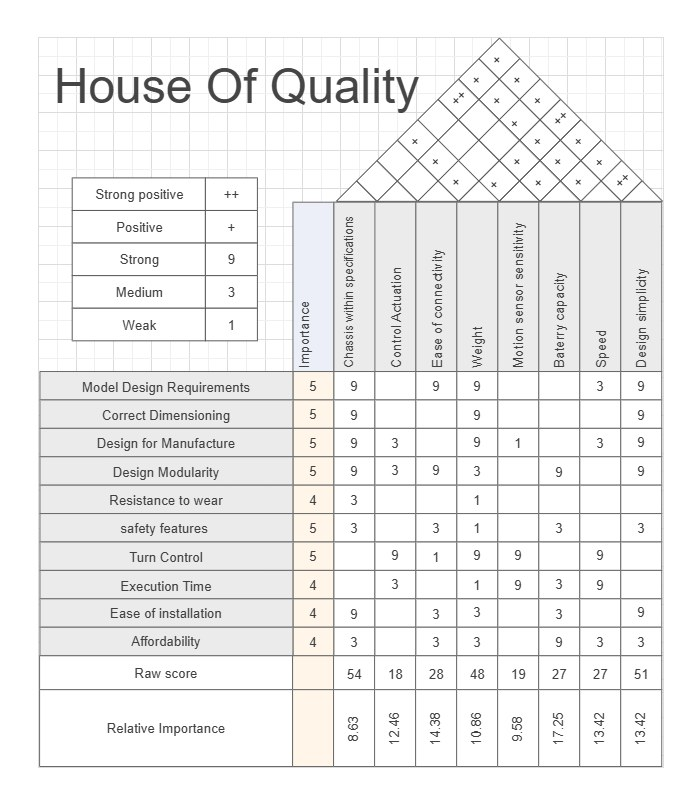
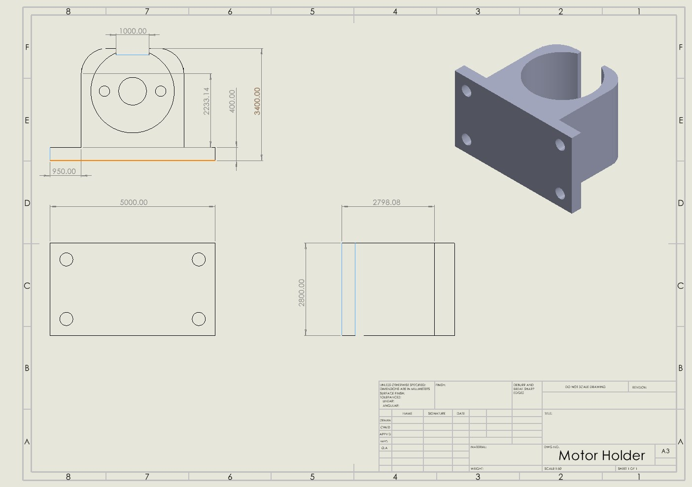
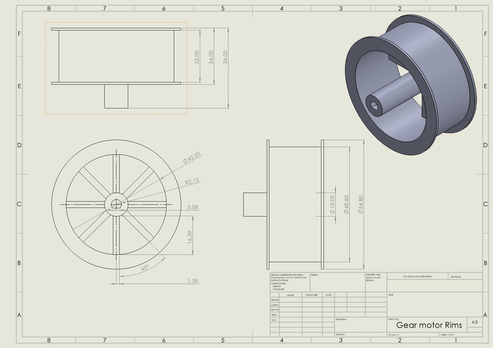

# Botzilla — Autonomous Delivery Robot


Four-wheel-drive autonomous robot built for a three-phase mechatronics design competition: cross mixed terrain, navigate a reconfigurable office-building maze (layout revealed only 24 h before), and deliver, stack and retrieve packages — with no human input.

<p align="center"></p>

## Highlights
- **Priority-based reactive state machine** (`firmware/phase-c-final/final_code_v2`) — emergency front stop with escape-direction choice → side-obstacle avoidance → differential wall-following that balances left/right distances inside a ±3 cm deadband.
- **Rate-limited sensing loop** (100 ms) fusing 3× HC-SR04 ultrasonic sensors and an MPU9250 IMU.
- **Skid-steer drive** through 2× TB6612FNG dual H-bridges with per-motor direction inversion.
- **3D-printed mechanical design** (chassis layers, motor mounts, gripper arm, wheel rims) in SolidWorks, traced to requirements through a House of Quality.

## Hardware
| Subsystem | Parts |
|---|---|
| Controller | Arduino Mega 2560 |
| Drive | 4× N20 encoder gear motors, 2× TB6612FNG drivers, LiPo battery |
| Sensing | 3× HC-SR04 ultrasonic (front/left/right), MPU9250 IMU, VL53L0X time-of-flight (Phase A/B) |
| Manipulation | Servo-driven gripper arm (Phase A/B) |

Full wiring is in [`hardware/wiring.md`](hardware/wiring.md).

<p align="center"></p>

## Repository layout
```
firmware/
  phase-a/          maze + curve navigation with VL53L0X ToF sensors, servo & motor bring-up
  phase-b-tests/    motor, MPU and ToF bring-up sketches for the redesigned chassis
  phase-c-final/    final competition firmware (final_code_v2 is the latest)
  phase-c-tests/    motor, MPU9250 and ultrasonic unit tests
cad/
  phase-a/ phase-b/ phase-c/   STL (and SolidWorks) parts for each design iteration
hardware/wiring.md
docs/images/
```

## Control logic (final firmware)
```
every 100 ms:
  read front / left / right distances + IMU
  if front < 15 cm          -> stop, turn toward the side with more clearance
  elif left or right < 12 cm -> steer away from the close wall
  else                      -> wall-follow: correct toward centre if |L - R| > 3 cm, else drive straight
```

## Build
1. Install the Arduino IDE and the **MPU9250_asukiaaa** library (Phase A/B sketches also use **VL53L0X** by Pololu and **Adafruit Motor Shield v1 / AFMotor**).
2. Open `firmware/phase-c-final/final_code_v2/final_code_v2.ino`, select **Arduino Mega 2560**, and upload.
3. Open the Serial Monitor at 115200 baud to watch the sensor log and current state.

## Design documentation
| House of Quality | Motor holder | Wheel rim |
|---|---|---|
|  |  |  |

---
Team project, MECE 4100U Mechatronics Design (Fall 2025). Portfolio: [tolujoshlad.wixsite.com/toluwanimi](https://tolujoshlad.wixsite.com/toluwanimi)
